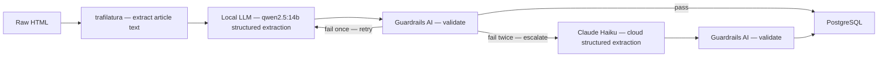

# ADR 004 — Recipe Parsing: LLM over Traditional Scraper

**Status:** Accepted (amended — local-first parsing)

## Context

We need to extract structured recipe data (title, ingredients with quantities and units, steps, metadata) from arbitrary URLs — any cooking website, food blog, or app link. Traditional approaches use HTML scraping with CSS selectors or recipe schema.org microdata.

## Decision

Use **LLM structured output** (tool/function calling with a strict JSON schema) as the parsing strategy, with HTML extraction (trafilatura) as the pre-processing step — as originally decided. The amendment is which model runs first: **Ollama `qwen2.5:14b` (local) is the primary parser**; `claude-haiku-4-5` (cloud) is an escalation path used only when the local model fails Guardrails validation twice in a row. See ADR-007 for the full local-vs-cloud boundary and rationale for this split.

Pipeline:

## Rationale

- **Robustness:** CSS selector scrapers are brittle — a site redesign breaks them. An LLM reads the semantic content of a page regardless of HTML structure, whether that LLM runs locally or in the cloud.
- **Handling variation:** Ingredient strings like "2 cloves garlic, finely minced" vs "garlic (2 cloves), minced" vs "2 garlic cloves" are trivially parsed by an LLM; rule-based parsers require extensive regex work and still fail on edge cases.
- **Structured output:** Ollama's JSON-schema-constrained decoding (`format` parameter) guarantees syntactically valid output regardless of model size — the same guarantee Claude's tool-calling API provides. Combined with Guardrails AI for semantic validation, the error rate is acceptable at either tier.
- **No maintenance:** A traditional scraper library needs constant updates as sites change. The LLM approach requires only prompt tuning if output quality degrades.
- **Local-first is viable here specifically because of the retry/escalation design:** a single bad local extraction doesn't reach PostgreSQL — Guardrails catches it, one local retry gets a second chance, and only a second consecutive failure pays for a cloud call. This keeps the original ADR's core promise (bad parses don't corrupt downstream data) while running the common case for free.

## Trade-offs

- **Cost:** Zero for parses the local model gets right (the large majority, expected from `qwen2.5:14b`'s structured-extraction capability on clean-to-moderate HTML). Escalated parses cost ~$0.001–0.003 in Haiku tokens — only paid on messy source HTML that fails validation twice.
- **Latency:** Local inference adds the retry's worth of extra round trips in the worst case, plus the async job queue already absorbs this — users submit and come back regardless of tier.
- **Privacy:** The majority of recipe content never leaves the machine. Only the minority that escalates is sent to Anthropic's API. An improvement over the original all-cloud design.
- **Accuracy ceiling:** `qwen2.5:14b` may be less reliable than Haiku on especially messy or unusually structured source HTML. The two-strike escalation path exists specifically to cover this — Guardrails is the gate, not a hope that local quality is always sufficient.

## Alternatives Rejected

**CSS selector scraper:** Works on popular sites that publish schema.org/Recipe microdata (AllRecipes, NYT Cooking) but fails on food blogs, personal websites, and any site without structured markup. Requires a different scraper per site.

**recipe-scrapers library (Python):** Covers 300+ sites with hand-written scrapers. Good coverage but still misses many sites and requires community maintenance. Does not handle arbitrary URLs.

**Cloud-first with no local tier (original decision):** Reliable, but puts every single parse through the billing meter and sends every recipe's content to Anthropic's API, even for pages a smaller local model would have handled correctly. Superseded by the local-first design once Guardrails-gated retry/escalation made a local primary tier safe to trust.

**Three-tier escalation (local → Haiku → Sonnet):** Considered for parity with the original Haiku→Sonnet escalation, but adds complexity without a demonstrated need — Haiku's own structured-extraction reliability is already high. Revisit only if the local→Haiku escalation tier itself starts failing Guardrails at a meaningful rate.
